<div align="center">

  

  <p align="center">
    <strong>Crafted in leather. Made to last.</strong><br />
    <em>A luxury omnichannel e-commerce ecosystem powered by a modern headless architecture.</em>
  </p>

  <p align="center">
    <a href="https://react.dev/"></a>
    <a href="https://vitejs.dev/"></a>
    <a href="https://tailwindcss.com/"></a>
    <a href="https://nodejs.org/"></a>
    <a href="https://www.mongodb.com/atlas"></a>
    <a href="https://woocommerce.com/"></a>
    <a href="https://razorpay.com/"></a>
  </p>

  <p align="center">
    <a href="#-system-architecture">Architecture</a> •
    <a href="#-live-system-showcase">Live Showcase</a> •
    <a href="#-key-features">Features</a> •
    <a href="#-tech-stack">Tech Stack</a> •
    <a href="#-project-structure">Structure</a> •
    <a href="#-quick-start">Quick Start</a> •
    <a href="#-deployment">Deployment</a>
  </p>

</div>

---

## 📖 Executive Overview

**Zayn Leathers** is an enterprise-grade luxury e-commerce platform designed for handcrafted genuine leather jackets, suede apparel, luxury coats, bespoke biker wear, and accessories. Built to deliver an uncompromising buyer journey, the platform combines a modern ultra-responsive React storefront with a full-featured executive admin management console and a resilient hybrid backend.

### 🌟 Key Highlights
- **Dual-Engine Architecture:** Seamlessly switches between a headless **Hostinger WooCommerce** backend (1,400+ active published catalog SKUs) and a dedicated **Node.js / Express / MongoDB** cluster.
- **Global Currency Engine:** Shop defaults to **USD** with real-time conversion across **USD**, **INR**, **GBP**, and **CAD**, transparently resolving checkouts in INR via Razorpay or COD.
- **Bespoke Made-to-Measure Studio:** Dedicated custom jacket atelier page enabling customers to configure measurements, upload inspiration photos, and initiate direct concierge consultations.
- **Executive Operations Suite:** Administrative control center with real-time Chart.js business analytics, order workflow tracking, PDF invoice generation, Cloudinary media syncing, and WhatsApp customer dispatch messaging.

---

## 🏛 System Architecture

The architecture decouples the customer-facing frontend and administrative interface from the core catalog and payment services, guaranteeing high performance, security, and effortless horizontal scalability.

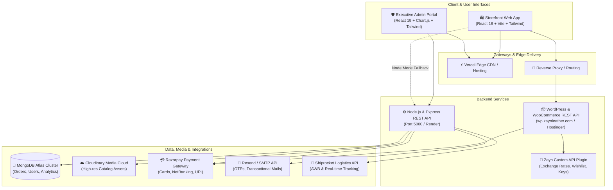

---

## 📸 Live System Showcase

All screenshots below were captured directly from the live running instance of the Zayn Leathers production-ready build.

### 🛍️ Storefront — Customer Experience

<table>
  <tr>
    <td width="50%">
      <div align="center">
        <h4>1. Hero Slider & Luxury Navigation</h4>
        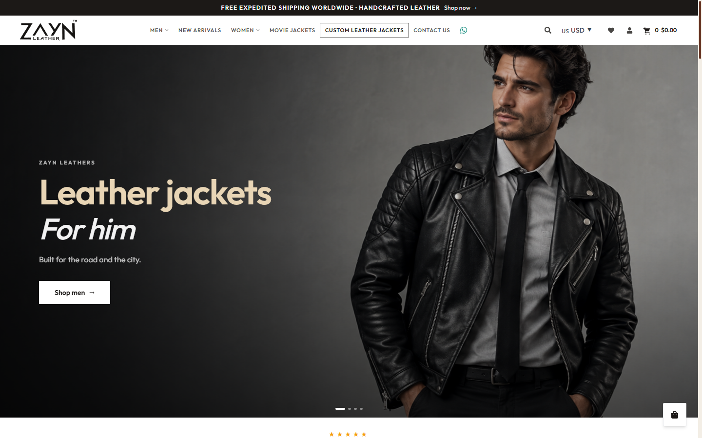
        <p><em>Curated hero banner showcasing new arrivals, multi-currency switcher (USD default), search bar, and direct WhatsApp concierge access.</em></p>
      </div>
    </td>
    <td width="50%">
      <div align="center">
        <h4>2. First-Visit Welcome Gift Modal</h4>
        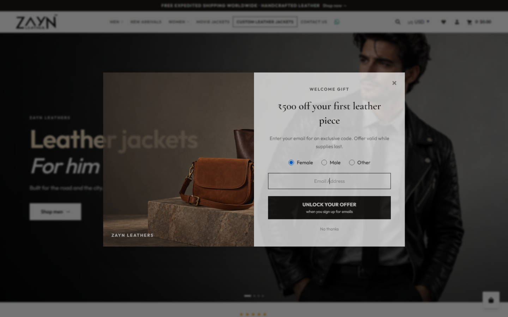
        <p><em>Split-image lead capture modal offering exclusive discounts (₹500 off) for first-time customers with gender-based preferences.</em></p>
      </div>
    </td>
  </tr>
  <tr>
    <td width="50%">
      <div align="center">
        <h4>3. Curated Category Showcase</h4>
        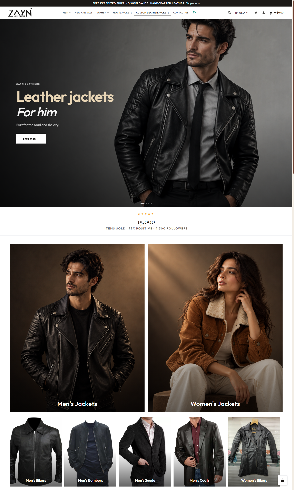
        <p><em>Editorial visual categories for Men's & Women's Jackets, Biker styles, Bombers, Suede, and Long Trench Coats.</em></p>
      </div>
    </td>
    <td width="50%">
      <div align="center">
        <h4>4. Craftsmanship Manifesto & Bestsellers</h4>
        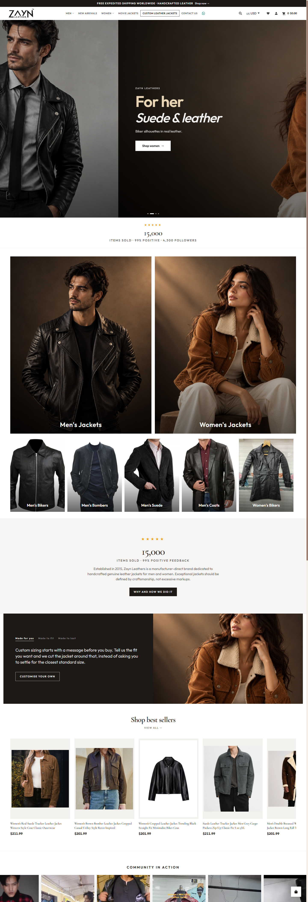
        <p><em>Brand heritage section highlighting direct-from-craftsman philosophy, social proof counters (15k+ sold), and trending bestsellers.</em></p>
      </div>
    </td>
  </tr>
  <tr>
    <td width="50%">
      <div align="center">
        <h4>5. Filterable Product Catalog</h4>
        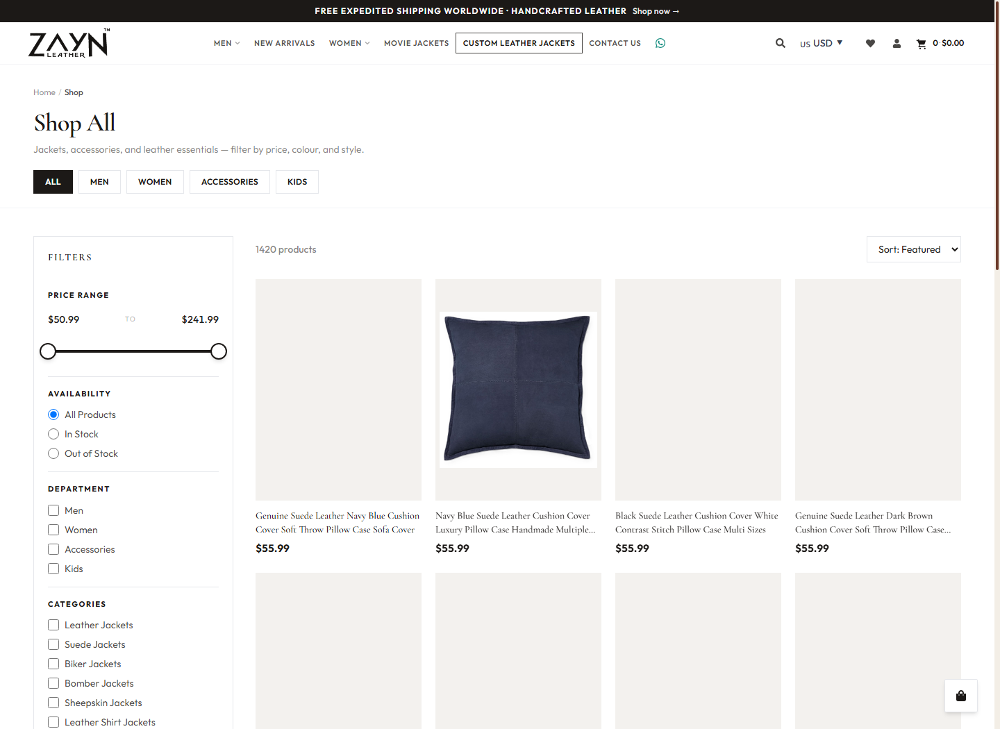
        <p><em>Dynamic product catalog (1,420+ products) with real-time price slider, department/category facets, stock filters, and sorting.</em></p>
      </div>
    </td>
    <td width="50%">
      <div align="center">
        <h4>6. Luxury Product Detail Page (PDP)</h4>
        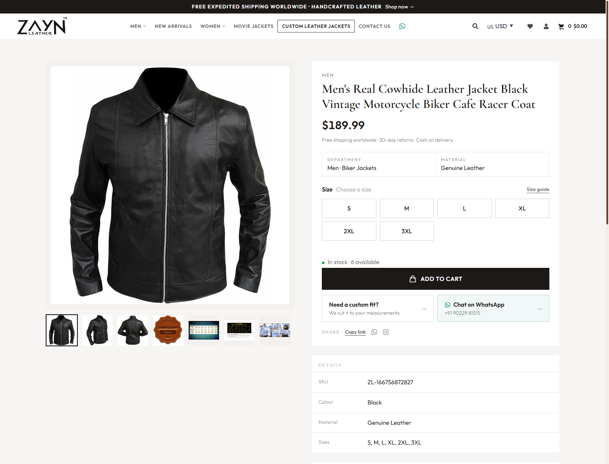
        <p><em>High-definition image carousel, multi-size selector (S to 3XL), stock availability badges, worldwide shipping guarantees, and size guide.</em></p>
      </div>
    </td>
  </tr>
  <tr>
    <td width="50%">
      <div align="center">
        <h4>7. Bespoke Custom Jackets Studio</h4>
        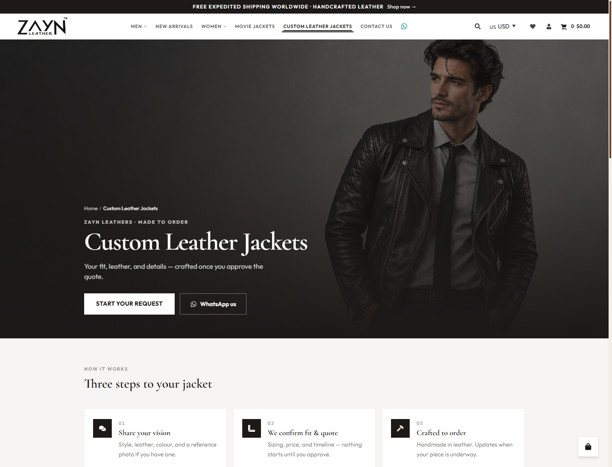
        <p><em>Interactive 3-step bespoke tailor service allowing customers to specify custom sizing, leather types, and collaborate via WhatsApp.</em></p>
      </div>
    </td>
    <td width="50%">
      <div align="center">
        <h4>8. Shopping Bag & Order Summary</h4>
        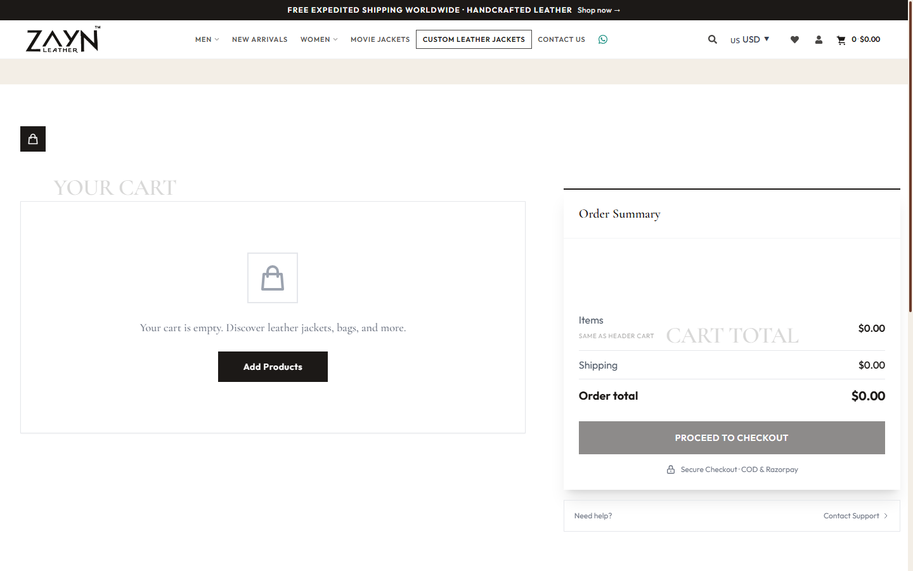
        <p><em>Clean cart drawer and page with free delivery progress calculation, coupon discounts, guest cart sync, and secure checkout CTA.</em></p>
      </div>
    </td>
  </tr>
</table>

---

### 🛡️ Admin Portal — Business Operations

<table>
  <tr>
    <td width="50%">
      <div align="center">
        <h4>9. Security & Admin Authentication</h4>
        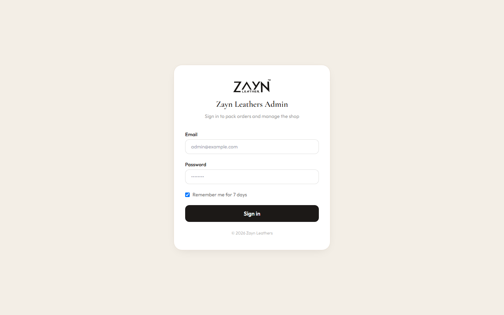
        <p><em>Secure JWT-backed administration access card with brand assets and session-remembering credentials protection.</em></p>
      </div>
    </td>
    <td width="50%">
      <div align="center">
        <h4>10. Executive KPI Dashboard</h4>
        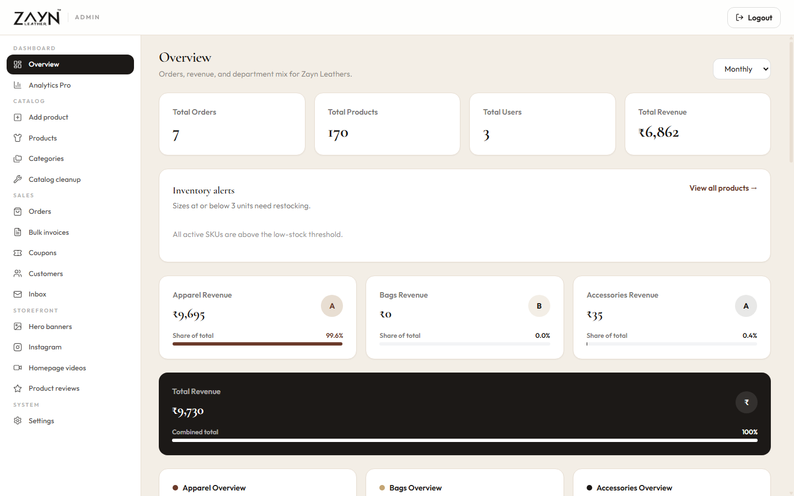
        <p><em>Real-time revenue metrics, total orders, low inventory alerts, and revenue breakdown by department (Apparel, Bags, Accessories).</em></p>
      </div>
    </td>
  </tr>
  <tr>
    <td width="50%">
      <div align="center">
        <h4>11. Analytics Pro Visualizer</h4>
        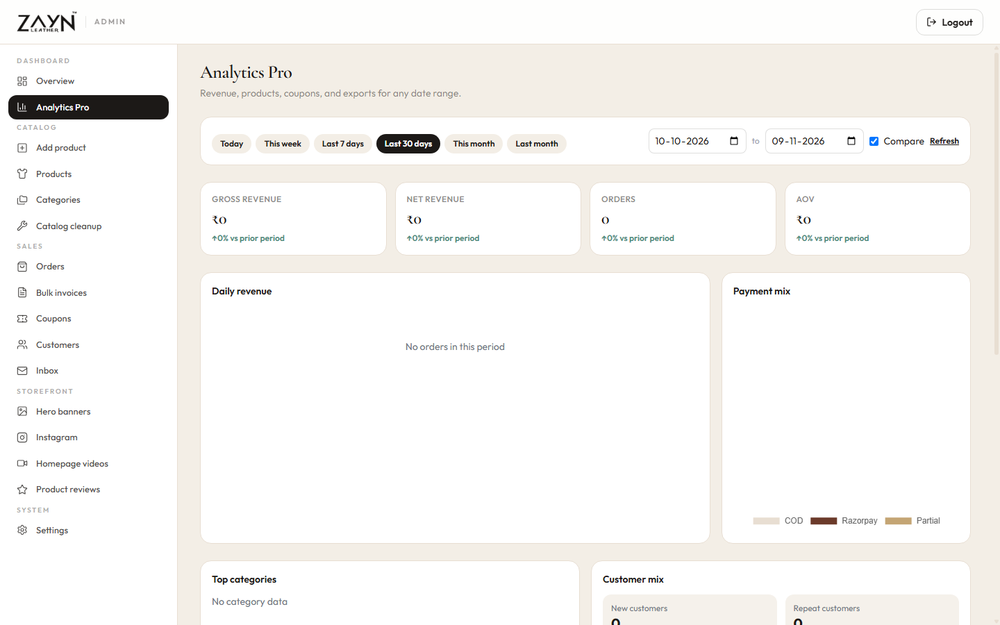
        <p><em>Interactive performance metrics with dynamic time frames (Today, 7D, 30D, Month), Average Order Value (AOV), and payment mix pie charts.</em></p>
      </div>
    </td>
    <td width="50%">
      <div align="center">
        <h4>12. Order Management & Dispatch</h4>
        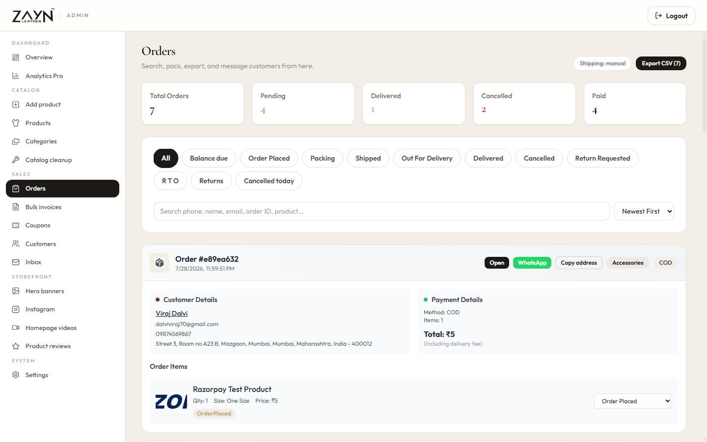
        <p><em>Comprehensive order processing lifecycle, payment status filters, CSV exports, customer address extraction, and direct WhatsApp alerts.</em></p>
      </div>
    </td>
  </tr>
  <tr>
    <td width="50%">
      <div align="center">
        <h4>13. Product Inventory & Grouped Styles</h4>
        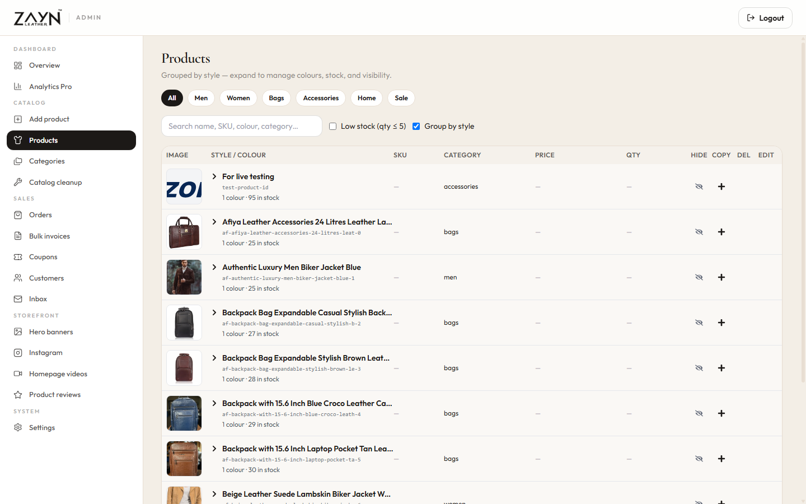
        <p><em>Inventory manager grouping variants by style, tracking stock counts, hiding/duplicating items, and quick inline editing.</em></p>
      </div>
    </td>
    <td width="50%">
      <div align="center">
        <h4>14. Product Studio & Size Matrix</h4>
        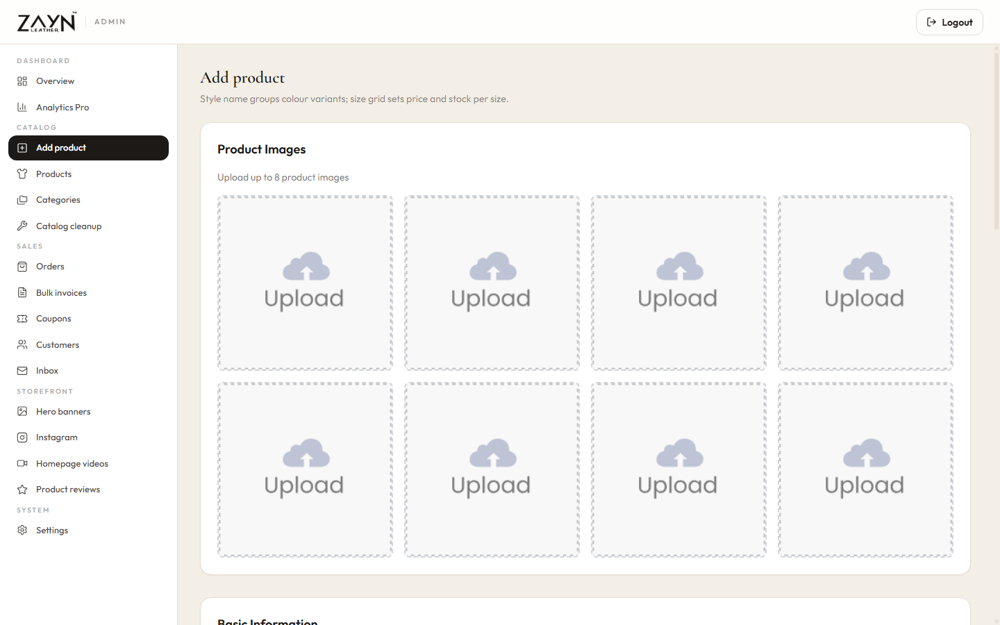
        <p><em>Up to 8 high-resolution Cloudinary image uploads, size-based price matrix manager, color variant grouping, and SEO tagging.</em></p>
      </div>
    </td>
  </tr>
  <tr>
    <td colspan="2">
      <div align="center">
        <h4>15. Category & Hierarchy Builder</h4>
        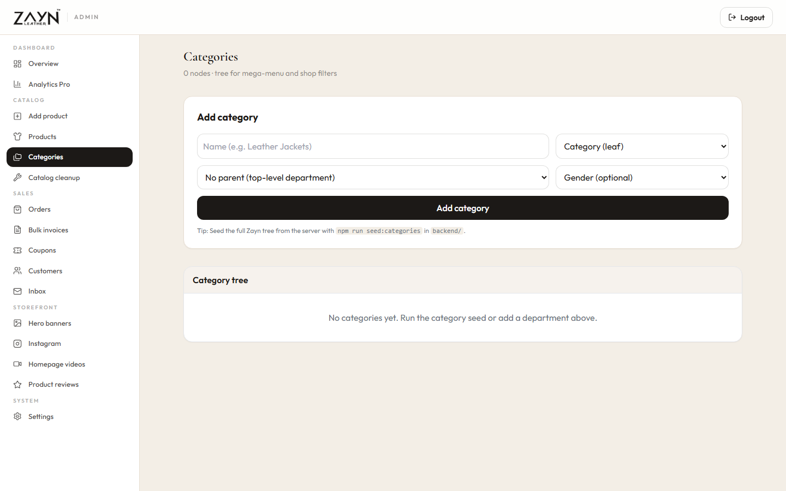
        <p><em>Visual tree manager configuring top-level departments, subcategories, mega menus, and storefront discovery tiles.</em></p>
      </div>
    </td>
  </tr>
</table>

---

## ⚡ Key Features Matrix

| Feature | Storefront (`/frontend`) | Admin Console (`/admin`) | Engine (`/backend` & `/wordpress`) |
| :--- | :--- | :--- | :--- |
| **Catalog & Products** | 1,420+ products, infinite scroll / pagination, multi-attribute filtering | Add/Edit styles, size matrix pricing, batch deletion, cleanup | WooCommerce REST v3 + MongoDB Atlas dual support |
| **Multi-Currency** | Real-time USD, INR, GBP, CAD switcher; automatic rate sync | Native currency indicators and localized reporting | Live rates fetched from exchange rate API via custom plugin |
| **Cart & Checkout** | Guest cart persistence (`localStorage`), token migration upon login | View customer cart trends & abandoned sessions | WooCommerce Store API / Express Cart endpoints |
| **Payments** | Razorpay (Credit/Debit, NetBanking, UPI), Cash on Delivery (COD) | Payment status tracking, transaction reference lookup | Automated signature verification & webhook listener |
| **Fulfillment & Logistics**| Real-time order tracking with status milestones | Label creation, bulk PDF invoice generation, status pipeline | Shiprocket integration with automated AWB generation |
| **Customer Engagement** | Lead-capture welcome popup, wishlist, review submissions | Manage reviews, compose WhatsApp updates, answer inbox | Transactional email delivery via Resend HTTP API & SMTP |
| **Media Pipeline** | Responsive responsive web images, lazy-loading, WebP support | Multi-file drag-and-drop uploader with auto-optimizations | Cloudinary automatic format/quality transformation |

---

## 💻 Tech Stack

### Storefront (`frontend`)
- **Core:** [React 18](https://react.dev/), [Vite 6](https://vitejs.dev/), [React Router 7](https://reactrouter.com/)
- **Styling:** [Tailwind CSS 3.4](https://tailwindcss.com/), [PostCSS](https://postcss.org/), [Autoprefixer](https://github.com/postcss/autoprefixer)
- **Animations:** [Framer Motion 12](https://www.framer.com/motion/), [AOS (Animate On Scroll)](https://michalsnik.github.io/aos/)
- **Icons & UI:** [React Icons (FontAwesome, Feather, Material)](https://react-icons.github.io/react-icons/), [React Toastify](https://fkhadra.github.io/react-toastify/)
- **Data & SEO:** [Axios](https://axios-http.com/), [React Helmet Async](https://github.com/staylor/react-helmet-async)

### Administration Portal (`admin`)
- **Core:** [React 19](https://react.dev/), [Vite 6](https://vitejs.dev/), [React Router 7](https://reactrouter.com/)
- **Styling:** [Tailwind CSS 3.4](https://tailwindcss.com/)
- **Charts & Visualizations:** [Chart.js 4.5](https://www.chartjs.org/), [React-Chartjs-2](https://react-chartjs-2.js.org/)
- **Icons:** [Lucide React](https://lucide.dev/), [React Icons](https://react-icons.github.io/react-icons/)
- **State & Context:** React Context API (`AdminFeaturesContext`)

### Backend Engine (`backend`)
- **Runtime:** [Node.js](https://nodejs.org/) (ES Modules)
- **Framework:** [Express 4.21](https://expressjs.com/) with CORS & `express-rate-limit`
- **Database:** [MongoDB Atlas](https://www.mongodb.com/atlas) via [Mongoose 9](https://mongoosejs.com/)
- **Authentication:** [JWT (JSON Web Tokens)](https://jwt.io/), [bcryptjs](https://github.com/dcodeIO/bcrypt.js)
- **File Handling:** [Multer](https://github.com/expressjs/multer), [Sharp](https://sharp.pixelplumbing.com/), [Streamifier](https://github.com/gabrielflorit/streamifier)
- **PDF Generation:** [PDFKit](https://pdfkit.org/)
- **Integrations:** [Cloudinary 2.5](https://cloudinary.com/), [Razorpay 2.9](https://razorpay.com/), [Resend 6.2](https://resend.com/), [Nodemailer](https://nodemailer.com/)

### WordPress Headless Plugin (`wordpress`)
- **Plugin:** `zayn-custom-api.zip` (Custom PHP REST API for WooCommerce)
- **Auth:** `JWT Authentication for WP-REST API`
- **Endpoints:** Currency exchange rates, dynamic shipping settings, customer wishlist, password resets, Razorpay credentials

---

## 📂 Project Structure

```text
ZaynLeathers/
├── admin/                         # Executive Administration Panel (React 19 + Vite)
│   ├── public/brand/              # Admin-specific brand icons & logos
│   ├── src/
│   │   ├── components/            # Sidebar, Navbar, WhatsAppCompose, SizeMatrixEditor
│   │   ├── context/               # AdminFeaturesContext
│   │   ├── pages/                 # Dashboard, Analytics, Orders, Add, List, Categories
│   │   └── App.jsx                # Admin routing & token persistence
│   ├── package.json
│   └── vite.config.js
│
├── backend/                       # Node.js Express REST API server
│   ├── config/                    # MongoDB Atlas & Cloudinary connections
│   ├── controllers/               # Analytics, Invoices, Orders, Products, Users
│   ├── middleware/                # Admin auth, user auth, file uploaders
│   ├── models/                    # Mongoose schemas (Product, Order, User, Coupon)
│   ├── routes/                    # Express routing tables
│   ├── seeds/                     # Database seeders (Categories, Products, Users)
│   ├── server.js                  # Main Express entrypoint
│   └── package.json
│
├── frontend/                      # Customer-Facing Storefront (React 18 + Vite)
│   ├── public/brand/              # High-resolution brand assets, heroes, categories
│   ├── src/
│   │   ├── api/                   # WooCommerce & Node API adapters (wooClient, shopApi)
│   │   ├── components/            # HeroSlider, Navbar, MegaMenu, WelcomePopup, ProductItem
│   │   ├── context/               # ShopContext (Cart, Currency, Products, Auth)
│   │   ├── pages/                 # Home, Shop, Products (PDP), Cart, CustomJackets
│   │   └── App.jsx                # Storefront routing & animations
│   ├── package.json
│   └── vite.config.js             # Vite dev server & WooCommerce proxy
│
├── shared/                        # Shared Brand Configuration & Whitelabel System
│   ├── brand.config.js            # Active brand router
│   └── brands/
│       └── zayn-leathers.js       # Complete Zayn Leathers metadata, colors, typography
│
├── wordpress/                     # Custom WordPress WooCommerce Plugin
│   ├── zayn-custom-api.zip        # Uploadable plugin archive
│   └── zayn-custom-api/           # Uncompressed PHP source code
│
├── docs/                          # Architecture guides, deployment plans, client contracts
│   ├── screenshots/               # Production screenshot suite (15 high-res captures)
│   ├── DEPLOY_ZAYN_LEATHERS.md    # Step-by-step production launch protocol
│   └── client_handover_requirements.md
│
├── scripts/                       # Catalog sync and migration tools
│   ├── import_store_catalog.py    # Python catalog pipeline
│   └── build_brand_icons.py       # Favicon and icon generation
│
└── README.md                      # Primary project documentation
```

---

## 🚀 Quick Start Guide

### Prerequisites
- **Node.js** (v18.x, v20.x, or v24.x recommended)
- **npm** (v10+ or v11+)
- **Python 3.10+** (optional, for migration scripts)

### 1. Clone & Install Dependencies

```bash
# Clone the repository
git clone https://github.com/your-username/zayn-leathers.git
cd zayn-leathers

# Install backend dependencies
cd backend && npm install

# Install admin dependencies
cd ../admin && npm install

# Install frontend dependencies
cd ../frontend && npm install
cd ..
```

---

### 2. Environment Configuration

#### `frontend/.env`
```env
# Backend mode: "woocommerce" for live catalog or "node" for Express API
VITE_BACKEND_MODE=woocommerce

# WooCommerce live store endpoint
VITE_WC_URL=https://wp.zaynleather.com
VITE_WC_CONSUMER_KEY=ck_your_consumer_key
VITE_WC_CONSUMER_SECRET=cs_your_consumer_secret

# Razorpay public key (leave empty until ready for live payments)
VITE_RAZORPAY_KEY_ID=rzp_live_your_key_id
```

#### `admin/.env`
```env
# Backend API address
VITE_BACKEND_URL=http://localhost:5000
```

#### `backend/.env`
```env
PORT=5000
NODE_ENV=development
ALLOW_DEV_OTP=true

# Database & Auth
MONGODB_URI=mongodb+srv://<user>:<password>@cluster0.mongodb.net/afiyaleathers
JWT_SECRET=your_super_secret_jwt_key

# CORS Whitelists
FRONTEND_URL=http://localhost:5173
ADMIN_URL=http://localhost:5174

# Admin Credentials
ADMIN_EMAIL=admin@example.com
ADMIN_PASSWORD=YourSecurePassword

# Cloudinary Storage
CLOUDINARY_NAME=your_cloud_name
CLOUDINARY_API_KEY=your_api_key
CLOUDINARY_SECRET_KEY=your_secret_key

# Transactional Mail (Resend or SMTP)
MAIL_PROVIDER=resend
RESEND_API_KEY=re_your_api_key
EMAIL_FROM="Zayn Leathers <orders@zaynleather.com>"
```

---

### 3. Launch Development Servers

You can run each service independently in separate terminal windows:

#### Terminal 1 — Backend API
```bash
cd backend
npm run dev
# Server listening on http://localhost:5000
```

#### Terminal 2 — Administration Portal
```bash
cd admin
npm run dev
# Vite server running on http://localhost:5174
```

#### Terminal 3 — Customer Storefront
```bash
cd frontend
npm run dev
# Storefront running on http://localhost:5173
```

---

## 🌐 Deployment Protocol

### 1. Storefront & Admin Portal → **Vercel**
1. Connect the GitHub repository to [Vercel](https://vercel.com).
2. Create **two separate projects**:
   - **Storefront:** Root directory set to `frontend/`. Build command: `npm run build`, Output: `dist`.
   - **Admin Portal:** Root directory set to `admin/`. Build command: `npm run build`, Output: `dist`.
3. Set the respective environment variables in the Vercel Dashboard.
4. Assign custom domains (e.g., `zaynleather.com` and `admin.zaynleather.com`).

### 2. Backend Engine → **Render**
1. Create a new **Web Service** on [Render](https://render.com).
2. Set Root Directory to `backend/`.
3. Build Command: `npm install`, Start Command: `node server.js`.
4. Configure production environment variables (`MONGODB_URI`, `JWT_SECRET`, `CLOUDINARY_*`, `RESEND_API_KEY`, `RAZORPAY_*`).

### 3. WordPress & WooCommerce Catalog → **Hostinger**
1. Confirm store currency remains **Indian Rupee (₹ / INR)** in WooCommerce Settings.
2. Upload and activate `wordpress/zayn-custom-api.zip` via WordPress Admin → Plugins.
3. Verify JWT Authentication endpoint is active.
4. Generate read/write REST API keys under **WooCommerce → Settings → Advanced → REST API**.

For the detailed deployment checklist, consult [`docs/DEPLOY_ZAYN_LEATHERS.md`](docs/DEPLOY_ZAYN_LEATHERS.md).

---

## 🔒 Security & Best Practices

- **Zero Secret Leakage:** All sensitive API keys, database credentials, and payment gateway secrets are strictly externalized via environment variables.
- **Rate Limiting:** Express API endpoints are protected using `express-rate-limit` against brute-force and DDoS attempts.
- **Input Sanitization:** Multi-layer input validation utilizing validator.js on incoming request payloads and address forms.
- **JWT Protection:** Short-lived tokens with secure role-based access control protecting all administrative endpoints.

---

## 📄 License & Attribution

Copyright &copy; 2026 Zayn Leathers. All rights reserved.  
Built and handcrafted with excellence for high-performance luxury retail.

---

<div align="center">
  <strong>Zayn Leathers</strong> • <em>Handcrafted Leather Excellence</em>
</div>
